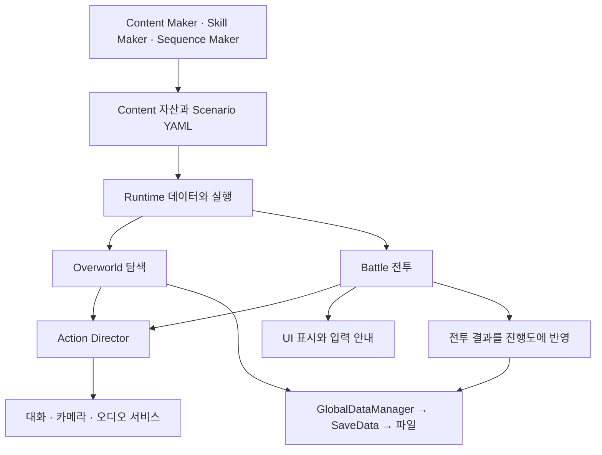

# 학습 시작과 전체 구조

[학습 홈](README.md) · [전체 코드 색인](20-code-atlas.md)

이 프로젝트는 Unity 6000.3.8f1 기반의 탐색·대화·턴제 전투 RPG입니다. **화면의 기능을 출발점으로, 데이터가 어디서 바뀌고 누가 정리하는지를 추적하는 것**이 학습의 중심입니다. 모든 파일을 첫 줄부터 외우는 방식은 권하지 않습니다.

## 먼저 구분할 네 가지

| 구분 | 프로젝트 예 | 무엇을 소유하는가 |
| --- | --- | --- |
| 제작 데이터 | CharacterData, SkillData, RoomDefinition | 여러 실행에서 공유하는 정의 |
| 현재 실행 상태 | CharacterBase, SkillContext, BattleSessionState | 지금 HP, 진행 중 행동, 전투 플래그 |
| 저장 데이터 | SaveData, CharacterSaveData, EncounterMemory | 게임을 껐다 켜도 남는 기록 |
| 표현 | PartySlotUI, BattleDamagePopupView, BattleTelegraphCue | 숫자·아이콘·애니메이션과 수명 |

ScriptableObject에 현재 HP나 압력을 저장하면 같은 자산을 참조한 세 캐릭터가 상태를 공유할 수 있습니다. 반대로 현재 압력을 무조건 세이브에 넣으면 “전투마다 초기화”라는 규칙이 깨집니다. 클래스 이름보다 **공유 범위와 수명**을 먼저 읽으세요.

## 실제 경계

화살표는 중요한 호출·데이터 관계를 요약한 것입니다. 모든 클래스의 일방향 의존성을 보장하는 정밀 의존성 그래프는 아닙니다. 기존 싱글톤 접근과 큰 조정 클래스도 남아 있습니다.

## 30분 단위 읽기

1. **게임 현상 한 개**를 고릅니다. 예: 장비를 빼면 최대 HP가 줄어든다.
2. 관련 데이터와 진입 메서드부터 찾습니다. EquipmentData → EquipmentLoadoutService.TryUnequip.
3. 입력 → 검사 → 상태 변경 → 표시 갱신 → 실패 처리를 종이에 그립니다.
4. 테스트 한 개를 읽고 입력과 기대 결과를 손으로 계산합니다.
5. AI 설명을 닫고 “왜 이 경계가 필요한가”를 본인 말로 적습니다.

## 추천 순서

| 단계 | 읽을 장 | 먼저 이해할 C# |
| --- | --- | --- |
| 1 | Shared → Characters | 값/참조, enum, List, Dictionary, 메서드 |
| 2 | Items → 저장 | interface, 결과 타입, 예외, 복사본 |
| 3 | Overworld → Dialogue → UI | MonoBehaviour 수명, 이벤트, 코루틴 |
| 4 | Battle → Skills | 상태 전환, 판정과 연출의 분리 |
| 5 | Scenario → Sequence Maker | 재귀, 그래프, 실행 취소, 명령 이력 |
| 6 | Camera → VFX → 검증 | 소유권, 풀링, 비용 측정 |

## 지금 프로젝트를 설명할 때 지킬 표현

- “속도에 따라 행동 빈도가 달라지는 이산 스케줄러”입니다. 동시 행동도, 단순 속도순 라운드도 아닙니다.
- 전투 중 저장 복원은 범위 밖입니다. 결과·조우 기억만 진행도에 남습니다.
- Game Module 경계가 있다는 것과 모든 미니게임이 완성됐다는 것은 다릅니다.
- AI 보조로 구현한 코드입니다. 본인이 직접 이해·검증·수정한 범위를 따로 기록해야 합니다.
- 현재 코드와 미커밋 변경을 기준으로 정리했습니다. 커밋된 원격 버전과 같다고 가정하지 마세요.

## 첫 공부 과제

- [ ] CharacterData와 CharacterBase의 차이를 예시로 설명한다.
- [ ] 장비 변경이 스탯 계산과 UI에 전달되는 경로를 그린다.
- [ ] 저장 실패가 원본 파티를 바꾸면 안 되는 이유를 설명한다.
- [ ] 한 가지 테스트의 조건을 바꾸고 결과를 먼저 예측한다.

근거: `README.md`, `CONTEXT.md`, `ProjectSettings/ProjectVersion.txt`. 폴더 이름은 오래된 architecture 메모의 Features 경로가 아니라 현재 `Assets/_Game/Scripts`를 따릅니다.
