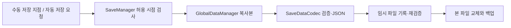

# Core 저장 입력과 전역 서비스

[학습 홈](README.md) · [전체 코드 색인](20-code-atlas.md) · [이 영역의 모든 파일](code/core.md)

**Core는 장면을 넘어 유지되는 상태와 공용 서비스를 연결합니다.** 모든 규칙을 Core로 모으는 것이 목적은 아닙니다. 전투 판정은 Battle, 장비 검사는 Characters처럼 실제 소유 영역에 둡니다.

## 읽을 순서

| 파일 | 집중할 내용 |
| --- | --- |
| Core/Runtime/GameBootstrap.cs | 시작 시 공용 객체 구성 |
| Core/Runtime/GameStateManager.cs | 탐색·대화·전투·일시정지의 큰 상태 |
| Core/Runtime/GameInput.cs | 동작명과 실제 입력, 중복 입력 억제 |
| Core/Runtime/GlobalDataManager.cs | 파티·인벤토리·플래그와 저장 경계 |
| Core/Runtime/SaveManager.cs | 저장 시점과 슬롯 정책 |
| Core/Runtime/SaveDataCodec.cs | 직렬화·버전·정규화 |
| Core/Runtime/AtomicSaveStorage.cs | 파일 교체와 복구 |
| Core/Runtime/GameLoadCoordinator.cs | 읽은 진행도를 게임에 적용하는 흐름 |

모든 경로의 앞에는 `Assets/_Game/Scripts/`가 붙습니다.

## 저장은 세 단계다

수동 슬롯은 **0~2**, 자동 슬롯은 **99**입니다. 설정의 PlayerPrefs와 진행도 슬롯은 별개입니다. 저장 지점에서 수동 저장하고, 자동 저장은 ProgressSaveTrigger로 지정한 이벤트에서 요청합니다. 모든 컷씬·보스전에 자동으로 붙어 있는 것은 아닙니다.

자동 요청은 하나로 합쳐집니다. 전투·결과·대화·씬 전환을 벗어나 탐색이 안정된 뒤 기록합니다. 새 게임이나 로드 시에는 이전 요청을 취소합니다. “요청 시점”과 “실제 스냅샷을 만든 시점”은 다릅니다.

### 왜 복사본인가

Codec.Encode는 호출자의 SaveData를 직접 정규화하지 않습니다. 저장 실패 후에도 현재 파티·장비·시간 정보가 이전과 같아야 하기 때문입니다. 얕은 복사는 내부 List와 원소를 공유할 수 있어 충분하지 않습니다.

### 왜 임시 파일과 백업인가

AtomicSaveStorage는 임시 JSON을 기록한 뒤 다시 읽어 검증합니다. 정상 본 파일이 있으면 File.Replace로 교체하면서 백업을 남깁니다. 본 파일이 손상되면 별도 보존 경로로 옮긴 뒤 새 파일을 배치합니다. 로드는 본 파일 → 백업 → 임시 후보를 검사합니다.

이는 게임 로직 차원의 복구 설계입니다. 모든 플랫폼의 전원 차단·파일 시스템·콘솔 인증 요건을 해결했다는 뜻은 아닙니다. 현재 SaveSchema.CurrentVersion은 4이며, 미래 버전 저장을 구버전으로 덮어쓰는 것도 차단합니다.

## 사용한 구조

- **Facade에 가까운 진입점**: SaveManager가 저장 정책을 모읍니다. 하지만 파일 I/O와 포맷 변환은 별도 클래스입니다.
- **Adapter / 의존성 역전**: ISaveFileSystem으로 실제 파일 시스템을 대체해 실패를 주입할 수 있습니다.
- **이벤트 방식**: EventManager 및 상태 변경 통지가 시스템 간 연결을 돕습니다. 구독 해제와 중복 구독은 호출자가 관리해야 합니다.
- **싱글톤**: 여러 Manager의 접근이 쉽지만 숨은 의존성이 생깁니다. “싱글톤을 썼으니 좋은 구조”라고 설명하지 마세요.

## 설정과 입력에서 배울 점

GameConfigManager는 값 변경을 즉시 적용하되 기록을 마지막 변경 후 **0.5초**로 묶습니다. 매 슬라이더 변화마다 디스크를 쓰는 일을 줄이는 지연 기록입니다. 종료·일시중지 때 기록하며 실패가 설정 모달 해제를 막지 않게 분리합니다.

GameInput의 메뉴 확정 소비는 동일한 Z 입력이 메뉴 확정 뒤 다음 방어 판정까지 사용되는 문제를 막습니다. 현재 물리 키가 눌렸는지와 “이 단계에서 새 입력으로 받아도 되는지”는 다릅니다.

## 공부 과제와 검증

- [ ] 정상 본 파일이 있는데 임시 파일 기록이 실패한 경우 남아야 할 파일을 그린다.
- [ ] 자동 저장 요청 직후 새 게임을 시작했을 때 세대 번호가 필요한 이유를 설명한다.
- [ ] 설정 저장 실패와 UI 닫기 실패를 분리해 설명한다.
- [ ] SaveDataCodecTests에서 원본 불변성 테스트를 읽는다.
- [ ] AtomicSaveStorageTests의 파일 교체 실패를 직접 추적한다.

기록된 검증: 2026-10-11 순수 관리형 검사 155/155, Runtime/Editor CLI 컴파일 오류 0. 이는 Unity 실기기 저장 검증이 아닙니다. 상세 범위는 [검증 장](19-verification.md)에서 확인합니다.

관련: [Characters](05-characters.md), [UI](12-ui.md), [자료구조](16-algorithms.md).
