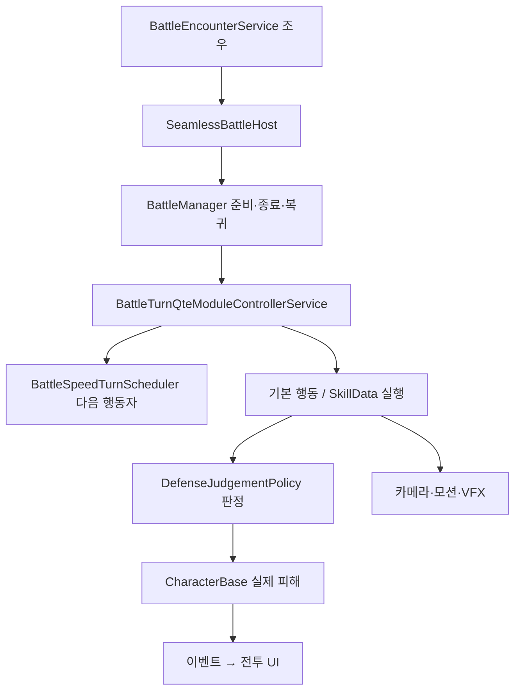

# Battle 턴 방어와 전투 수명

[학습 홈](README.md) · [전체 코드 색인](20-code-atlas.md) · [이 영역의 모든 파일](code/battle.md)

**전투의 핵심은 “누가 행동하는가”, “입력을 언제 판정하는가”, “그 결과를 언제 보여 주는가”를 서로 다른 책임으로 다루는 것입니다.**

## 진입 경로



BattleManager는 여전히 큰 조정자입니다. 서비스 분리가 진행됐지만 완전히 작은 순수 도메인 구조가 된 것은 아닙니다.

## 속도 턴 알고리즘

`Battle/Runtime/Services/BattleSpeedTurnScheduler.cs`는 각 참가자에 남은 작업량 Remaining과 속도 Speed를 저장합니다. 초기 작업량은 1000입니다.

1. 각 참가자의 도착 시간 `Remaining / Speed`를 계산합니다.
2. 가장 짧은 시간을 선택합니다. 동률은 최초 등록 순서입니다.
3. 모든 참가자에서 `경과 시간 × Speed`를 뺍니다.
4. 선택된 참가자만 작업량을 1000으로 되돌립니다.

```csharp
// 실제 구현의 핵심 구문
double time = entries[i].Remaining / entries[i].Speed;
entry.Remaining = Math.Max(0d, entry.Remaining - elapsed * entry.Speed);
```

속도 A=20, B=10이면 같은 초기 조건에서 A가 먼저 움직입니다. 50만큼 진행한 뒤 A는 1000으로 초기화되고 B는 500이 남습니다. 다음에는 도착 시간이 둘 다 50입니다. A가 먼저 등록됐다면 A가 한 번 더 행동하고, 그 직후 B는 남은 시간이 0이므로 행동합니다. **벽시계 시간 50초를 기다리는 구현이 아닙니다.** 행동 경계에서 이산 시간을 계산합니다.

메뉴를 오래 열거나 연출을 길게 재생해도 턴 작업량은 진행하지 않습니다.

## 턴 예고가 실제 진행을 바꾸지 않게

AppendPreview는 Entry 목록을 복사하고 같은 계산을 복사본에 적용합니다. 예상 중 버프가 끝나는 경우에는 참가자별 가상 완료 횟수로 미래 속도를 조회합니다. 실제 버프·AP·피해를 틱하지 않습니다.

- 한 번 선택: 참가자 N명에 대해 O(N).
- K칸 예고: 속도 조회 비용을 제외하면 O(N×K).
- Synchronize는 참조 검색을 반복하므로 일반적으로 O(N²)입니다.
- 소수 참가자 전투에 단순 목록은 합리적입니다. 힙으로 바꾸려면 속도 변경·제거·동률·예고까지 복잡해지는 비용을 비교해야 합니다.

## Z X C 판정과 전조

| 입력 | 기본 의미 | 주의할 경계 |
| --- | --- | --- |
| Z 유지 | 일반 방어로 피해 감소 | 미리 누른 상태와 새로운 정확한 입력은 다름 |
| 새 Z 입력 | Just Guard | 성공 시 무피해와 설정된 보상 |
| X | 회피 | 무피해 대응, Z 보상을 자동 지급하지 않음 |
| C | Counterable 공격의 특수 반격 | 일반 공격에 아무 때나 쓰는 만능 방어가 아님 |

세부 판정은 DefenseJudgementPolicy가 소유합니다. QTEManager는 입력 시간과 방어 창 실행을 연결합니다. 적의 공격 대응 창과 아군 공격 스킬용 QTE 패널은 같은 기능이 아닙니다.

전조의 START 애니메이션·핑·입력 창은 공통 타격 시계를 봅니다. BattleImpactTiming은 공격 소유자 쪽만 짧게 느리게 만들고 전역 Time.timeScale은 바꾸지 않습니다. 넓어진 판정 창은 난이도와 실제 애니메이션에 맞춰 검증해야 하며 “전조를 보이면 무조건 성공”이라는 규칙은 아닙니다. 입력 종류·Counterable 제한·새 입력 여부도 조건입니다.

## 전열과 후열

현재 전열이 모두 쓰러지고 살아 있는 후열이 있으면 계속 싸우기/포기를 묻습니다. 계속 싸우기에서 기존 전열이 사라지고 후열이 들어옵니다. 포기는 후열을 꺼내지 않고 게임오버로 갑니다. 이때 적의 스케줄 진행을 새 전투처럼 초기화하면 안 됩니다.

관련 파일: BattleManager, BattlePartyWavePresentation, BattleReserveChoiceUI, BattlePartyWaveRuntimeTests.

## 적 타깃 선정

BattleEnemyTargetSelector는 **최근 네 번의 고정 배열 기록 + 가중 랜덤**입니다. 최근에 많이 맞은 대상과 직전 대상을 덜 고릅니다. 다른 대상이 있으면 같은 대상 세 번 연속은 금지합니다. 이는 순환 공격도, 플레이어 입력을 읽는 예측 AI도 아닙니다. 표본값을 외부에서 받아 테스트를 재현할 수 있습니다.

## 공부 과제

- [ ] A=20, B=10의 다음 6번 행동을 손으로 계산한다.
- [ ] 예고를 100번 조회해도 실제 다음 행동자가 같아야 하는 테스트를 설명한다.
- [ ] 전조 전 잘못 누른 입력이 이후 정상 입력을 막으면 왜 불공정한지 설명한다.
- [ ] 전투 중단 경로에서 QTE, 카메라, 입력, 피해 묶음을 누가 정리하는지 표시한다.

읽을 파일: BattleManager → BattleTurnQteModuleControllerService → BattleSpeedTurnScheduler → DefenseJudgementPolicy → QTEManager. 테스트: BattleSpeedTurnSchedulerTests, DefenseJudgementPolicyTests, QTEManagerDefensePipelineTests, BattlePartyWaveRuntimeTests.

관련: [Skills](04-skills.md), [Camera](13-camera.md), [UI](12-ui.md).
