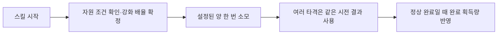

# 스킬 블록과 실시간 QTE

[학습 홈](README.md) · [전체 코드 색인](20-code-atlas.md) · [이 영역의 모든 파일](code/battle.md)

스킬은 이름별 switch 문이 아니라 **데이터에 들어 있는 행동 블록의 조합**으로 구성됩니다. 다만 모든 액션 시스템이 같은 것은 아닙니다. SkillActionBlock은 전투 스킬 실행용이고 Scenario의 Action은 전투 밖까지 쓰는 흐름 제어용입니다.

## 먼저 열 파일

| 파일 | 질문 |
| --- | --- |
| Battle/Data/SkillData.cs | 비용·대상·피해·블록 목록은 어디에 있는가 |
| Battle/Data/SkillActionBlocks.cs | 블록 하나는 어떤 계약으로 실행되는가 |
| Battle/Data/SkillElementalEffects.cs | 확정 타격과 속성 상태는 어디서 연결되는가 |
| Battle/Data/SkillResourceEffect.cs | 자원 조건 강화와 소모는 언제 평가되는가 |
| Scenario/Runtime/Presentation/BattleSkillTimelineRunner.cs | 시나리오에서 기존 스킬 실행을 어떻게 호출하는가 |
| Editor/SkillMaker/SkillMakerBlockEditor.cs | 제작 데이터가 편집 UI에 어떻게 표현되는가 |

## 실제 타입의 역할

`SkillActionBlock.Execute(SkillContext)`는 IEnumerator입니다. 이동·애니메이션·대기·피해·VFX·QTE·방어 창 등의 블록이 동일 계약을 따릅니다. SkillContext는 이번 시전의 행동자·대상·자원·방어·연출 상태를 연결합니다. 공유 SkillData를 현재 시전 상태 저장소로 쓰지 않는 것이 중요합니다.

| 블록 | 담당 | 혼동하면 안 되는 것 |
| --- | --- | --- |
| Action_Move | 이동 연출 | 이동이 곧 피해 적용은 아님 |
| Action_PlayAnim | 공격·대기 등 애니메이션 | 완료 콜백이 피해 시점과 자동 일치하지 않음 |
| Action_Damage | 확정 타격 경로 | UI 숫자를 먼저 바꾸고 HP를 나중에 맞추지 않음 |
| Action_QTE | 아군 공격용 실시간 입력 | 적 공격 대응 패널이 아님 |
| Action_DefenseWindow | 대응 시간과 타격 계약 | 전조 애니메이션 자체가 판정 로직은 아님 |
| Action_Projectile / Action_SequentialMelee | 발사체 / 연속 접근 공격 | 인접 방어 블록과 타격 시계 동기화 확인 |
| Action_EnemyWindup | 적 준비 클로즈업과 준비 자세 | 준비 중 방어 판정을 시작하지 않음 |

## Command 계열로 읽는 이유

블록은 “무엇을 실행할지”를 데이터와 실행 계약으로 캡슐화합니다. 전형적인 명령 객체와 닮았지만 **런타임 스킬 블록에 자동 Undo가 있는 것은 아닙니다.** 취소는 부수효과를 거꾸로 재생하는 일이 아니라 남은 실행을 멈추고 소유한 자원을 정리하는 일입니다.

## 압력 강화의 예

위젤 압력은 CharacterBattleResource에 있으며 최대 단계는 정의 데이터에서 읽습니다. 공유 정의와 캐릭터별 현재량이 분리됩니다.

강화 조건은 스킬 사용 불가 조건과 다릅니다. 기본 스킬은 사용할 수 있고 조건 충족 시 강화됩니다. 매 타격마다 압력을 소모하거나, 취소된 스킬에 완료 획득량을 지급하면 안 됩니다.

## 동시에 진행되는 QTE

공격 모션이 QTE 전체 입력을 기다린 뒤 시작하는 구조와, 모션 진행 중 QTE를 수집하는 구조는 다릅니다. Action_RapidStrikes와 QTEManager.RhythmSkill의 실행 수명을 함께 읽으세요. 코루틴의 동시 진행은 일반적으로 Unity 메인 스레드에서 프레임마다 번갈아 진행하는 것이지 멀티스레드가 아닙니다.

## 스킬을 공부하며 바꿔 볼 때

1. 기존 샘플을 복제하고 ID·카탈로그 참조를 검사합니다.
2. 이동 → 준비 → 타격 → 복귀의 타이밍을 먼저 단순화합니다.
3. 피해를 한 번만 넣고 HP·숫자·상태 반응이 같은 시점인지 확인합니다.
4. QTE·속성·자원 강화는 하나씩 추가합니다.
5. 중간 취소와 대상 사망을 넣어 정리 경로를 확인합니다.

사용 메뉴: **Hub To Home → 제작 → 스킬 메이커**. 플레이어용 설명은 효과와 용도를 적고, 내부 블록 순서나 Z/X/C 판정 프레임을 장황하게 노출하지 않습니다.

- [ ] “피해 적용”과 “피해 표시”가 다른 책임인 이유를 설명한다.
- [ ] 10연타에서 자원 소모가 한 번이어야 하는 위치를 찾는다.
- [ ] 중단된 코루틴에서 finally와 명시적 취소가 각각 필요한 이유를 조사한다.

관련: [Characters](05-characters.md), [Scenario 실행](09-scenario-runtime.md), [제작 도구](11-editor-tools.md).
