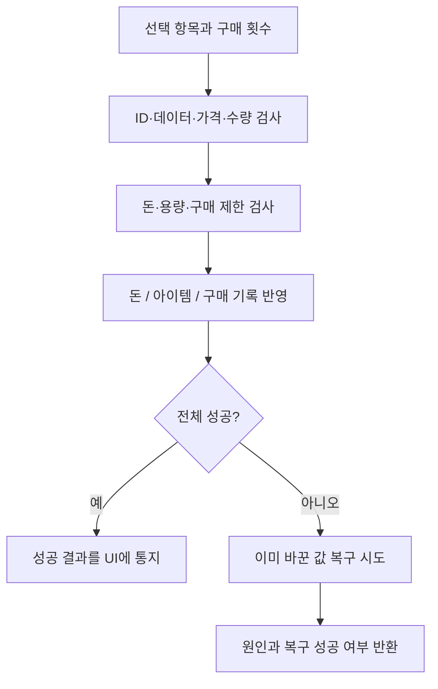

# Items 인벤토리와 상점 거래

[학습 홈](README.md) · [전체 코드 색인](20-code-atlas.md) · [이 영역의 모든 파일](code/items.md)

상점은 버튼 몇 개보다 **돈·수량·구매 제한·회복을 일관되게 갱신하는 일**이 더 중요합니다. UI가 거래 규칙까지 직접 수행하면 닫기·연타·예외에서 상태가 어긋나기 쉽습니다.

## 읽을 파일과 소유권

| 파일 | 담당 |
| --- | --- |
| Items/Data/ItemData.cs / ItemDatabase.cs | 아이템 정의와 조회 |
| Items/Data/ShopDefinition.cs | 판매 항목·가격·서비스·대화 |
| Items/Runtime/InventoryManager.cs | 인벤토리 사용 경로 |
| Items/Runtime/ItemEffectService.cs | 효과 적용 |
| Items/Runtime/ShopTransactionService.cs | 구매 검사·확정·복구 |
| Items/Runtime/ShopSellTransactionService.cs | 판매 |
| Items/Runtime/ShopServiceTransactionService.cs | 회복 등 서비스 |
| Items/Runtime/IShopTransactionStore.cs | 거래 저장소 계약 |
| Items/Runtime/GlobalDataShopTransactionStore.cs | 실제 진행도에 연결 |
| UI/Runtime/ShopSession.cs / ShopUI.cs | 상점 수명과 화면 |

## 구매 한 번의 흐름

IShopTransactionStore에는 TrySpendMoneyExact, TryAddItemExact, TrySetFlag 같은 좁은 계약이 있습니다. “false 또는 예외일 때 변경이 없어야 한다”는 계약을 구현체가 지키지 않으면 서비스의 복구 논리도 성립하지 않습니다.

ShopPurchaseResult는 단순 bool보다 자세합니다. 실패 원인, 거래 수량, 가격, 복구 시도 여부와 복구 성공 여부를 남깁니다. 이는 데이터베이스의 ACID 트랜잭션을 도입했다는 뜻이 아니라 **게임 메모리 상태를 일관되게 바꾸고 실패를 설명하는 설계**입니다.

## 정수 넘침을 왜 확인하는가

가격×수량이 int 범위를 넘으면 음수 가격처럼 보일 수 있습니다. 테스트 콘텐츠에서도 잘못된 데이터는 들어올 수 있으므로, 큰 값을 먼저 계산하고 허용 범위를 검증하는 경계가 필요합니다. UI에서 수량을 작게 제한했다는 이유만으로 서비스 검사를 없애지 않습니다.

## UI와 연출은 거래와 다르다

아이템이 정상 구매된 뒤 효과음 재생이 실패했다고 구매를 다시 시도하면 중복 지급할 수 있습니다. 상태 확정과 화면 피드백은 구분해야 합니다. 상점 진입 BGM과 필드 환경음은 별도 채널이며, 환경음 억제 범위는 종료·중단에서 반납해야 합니다.

## 패턴과 대안

- **Adapter**: GlobalDataShopTransactionStore는 진행도 객체를 상점 계약에 맞춥니다.
- **의존성 역전**: 서비스가 구체적인 UI나 MonoBehaviour 대신 interface를 받습니다.
- **보상 동작**: 단계별 실패 때 이미 변경한 항목을 되돌립니다. 롤백 자체 실패도 결과에 남깁니다.
- 모든 작은 함수에 interface를 붙인 것이 아니라 실패를 주입할 의미 있는 저장소 경계에 사용합니다.

## 공부 과제

- [ ] 돈 차감 성공 후 아이템 추가 실패에서 복구 순서를 적는다.
- [ ] 같은 EntryId 중복이 왜 오류인지 설명한다.
- [ ] 회복할 사람이 없는 무료 회복 서비스의 기대 결과를 정한다.
- [ ] UI 없이 가짜 IShopTransactionStore로 실패를 재현하는 테스트를 읽는다.

테스트: ShopTransactionServiceTests, InventoryConsumptionTests, UI의 ShopSessionTests. 관련: [Core 저장](02-core-save-input.md), [UI](12-ui.md).
