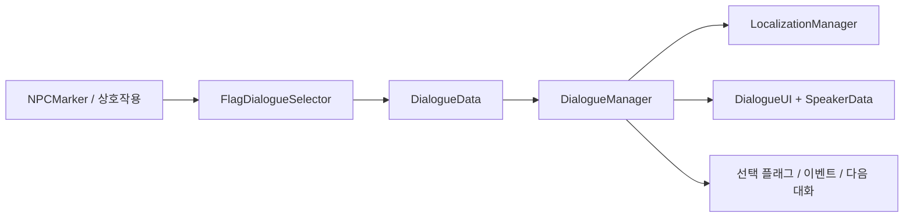

# Dialogue 대사 분기 번역과 전투 대화

[학습 홈](README.md) · [전체 코드 색인](20-code-atlas.md) · [이 영역의 모든 파일](code/dialogue.md)

대사 내용은 DialogueData, 화자·표정은 SpeakerData, 재생은 DialogueManager, 화면은 DialogueUI가 담당합니다. **대사를 프리팹 컴포넌트마다 길게 작성하는 방식과 분리**되어 있습니다.

## 대사 한 줄의 데이터

DialogueNode에는 Speaker, Emotion, LocalizationKey, DefaultText, EventTriggerID와 선택지 목록이 있습니다. ChoiceData는 다음 DialogueData, 선택 플래그, 전투 시작 여부를 가집니다.

DefaultText는 제작 중 확인용 기본 문장입니다. LocalizationKey와 표시 문장을 같은 것으로 취급하면 번역 교체가 어려워집니다. 다만 모든 선택지·UI 문구가 완전히 현지화 완료됐다고 단정할 수는 없습니다. 실제 ChoiceText 해석과 번역 누락 fallback은 각각 확인해야 합니다.

## 조건별 대사

FlagDialogueSelector는 플래그 값 비교와 우선순위에 따라 대화를 선택합니다. 세계의 상태를 변경하는 FlagStateBinder와 대사를 고르는 Selector는 구분됩니다. “대화가 한 번 끝났음”을 저장할지, “이번 전투에서만 말했음”을 기억할지도 다릅니다.

## 전투 중 두 종류의 말

| 종류 | 화면·진행 | 관련 코드 |
| --- | --- | --- |
| 메인 대화 | 기존 서브메뉴 영역에 대화 UI, 명령 입력 잠금 | BattleDialogueLayout, BattleMenuUI, DialogueManagerRunner |
| 짧은 말풍선 | 캐릭터 근처 텍스트/아이콘 반응 | BattleSpeechBubble, BattleSpeechConfig |

메인 대화를 넣었다고 짧은 말풍선의 수명과 레이아웃을 함께 변경하지 않습니다. BattleDialogueLayout은 임시 배치와 글자 설정을 소유하고, 메뉴 가림·입력 잠금은 BattleMenuUI가 소유합니다. 종료 후 탐색 대사의 원래 기하를 복구합니다. 대화 중 전투 상태가 바뀌면 옛 메뉴 상태를 무조건 되살리지 않아야 합니다.

## CSV는 런타임이 아니라 제작 교환 형식

ContentMakerDialogueCsv는 스키마 버전과 헤더를 가진 전체 대화 교환 형식입니다. document / node / choice 행을 구분하고 화자·다음 대화의 GUID·경로, 표정, 키, 플래그를 다룹니다.

파싱은 자산을 바꾸지 않습니다. 내용을 모두 검사한 후 적용해야 중간 오류로 대본 절반만 교체되는 일을 막습니다. 따옴표·쉼표·줄바꿈과 엑셀 수식으로 오인되는 텍스트도 중요한 경계입니다. 단순 Split(',')로 CSV를 읽어서는 안 됩니다. 이 기능을 .xlsx 직접 편집기라고 설명하면 안 됩니다.

## 패턴 해설

- **표현 분리**: 데이터·재생·화면이 구분됩니다. 프로젝트 전체가 엄격한 MVC라고 과장하지 않습니다.
- **규칙 평가**: 플래그 조건과 우선순위로 분기를 고릅니다.
- **Adapter**: DialogueManagerRunner가 Scenario의 대화 계약을 기존 재생기에 연결합니다.
- **범위 복구**: 전투용 배치는 대화 수명에만 적용되고 종료에서 해제됩니다.

## 공부 과제

- [ ] 선택지가 다음 대화로 이어지는 과정을 디버거 없이 종이에 추적한다.
- [ ] 번역 키가 없는 경우 어떤 문자열이 표시되는지 실제 메서드를 찾는다.
- [ ] 대화 취소와 정상 완료에서 플래그를 언제 써야 할지 구분한다.
- [ ] 메인 대화 중 메뉴 키를 누르고 대화가 끝난 프레임에 같은 입력이 새 메뉴를 실행하지 않게 하는 경로를 찾는다.

테스트: DialogueStateRestoreTests, DialogueChoiceLayoutTests, BattleDialoguePresentationTests, BattleSpeechBubbleLayoutTests, ContentMakerDialogueCsvTests.

관련: [Shared 줄바꿈](15-shared.md), [Scenario](09-scenario-runtime.md), [UI](12-ui.md).
