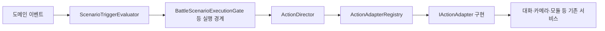

# Scenario 액션 실행과 취소

[학습 홈](README.md) · [전체 코드 색인](20-code-atlas.md) · [이 영역의 모든 파일](code/scenario.md)

Scenario는 특정 보스 이름을 코드로 검사하지 않고, **이벤트에 반응해 대화·연출·모듈 전환을 실행하는 공용 흐름**을 다룹니다. 실제 콘텐츠가 없는 기능까지 완성됐다고 해석하면 안 됩니다.

## 용어부터 고정

| 용어 | 현재 의미 |
| --- | --- |
| Primary Mode | Overworld 또는 Battle |
| Game Module | 각 모드 안의 규칙·입력·UI 묶음 |
| Action Sequence | 순차·병렬·대기 등으로 구성된 실행 데이터 |
| Action Director | 액션을 실행·취소하고 결과를 모으는 실행기 |
| Action Catalog | Action ID, 파라미터, 한국어 설명, 검증 계약 |
| Trigger Rule | 어떤 이벤트·조건에서 어떤 시퀀스를 요청하는가 |
| Encounter Memory | 재조우·승리·이미 발생한 사건 등 저장되는 기록 |
| Battle Session State | 이번 전투 동안 유지되며 중간 저장하지 않는 상태 |

## 런타임 경로



Trigger는 도메인의 사실을 관찰합니다. 시나리오가 캐릭터의 모든 피해 계산을 새로 소유하지 않습니다. Battle 전용 옛 규칙은 호환 매핑을 거쳐 일반 Trigger 모델로 연결됩니다.

## 실행의 세 객체

- **Context**: 이번 실행에서 사용할 서비스·값·대상을 제공합니다.
- **Handle**: 완료·실패·취소와 결과를 나타냅니다.
- **Session**: 현재 블록, 이벤트 기록, 일시정지·한 단계 실행 같은 관찰 상태를 모읍니다.

세 역할을 Coroutine 하나에 몰아넣으면 제작 도구가 “어느 블록에서 멈췄는가”를 알기 어렵습니다. ActionExecutionSession은 Dictionary로 블록 상태와 부모를 조회하고 List로 활성 순서를 유지합니다.

## Adapter 패턴을 쓰는 이유

DialogueWaitActionAdapter는 DialogueManager의 구체적인 사용을 Scenario 액션 계약으로 연결합니다. BgmCrossfadeActionAdapter, TimelinePlayActionAdapter, BattleSkillTimelineActionAdapter도 같은 종류의 경계입니다.

새 액션을 추가할 때 실행 C#만 만들면 부족합니다. Action Catalog의 ID·설명·파라미터·검증과 실제 Adapter가 일치해야 제작자가 발견하고 안전하게 사용할 수 있습니다.

## 병렬과 취소

flow.parallel은 스레드를 생성하는 것이 아니라 하위 IEnumerator를 함께 진행하는 실행 구조입니다. 완료 정책에 따라 형제 실행의 취소와 정리가 필요합니다. ActionDirector는 부모 종료·실패·코루틴 Dispose에서 남은 하위 실행을 CancelAndDrain으로 정리합니다.

취소가 이미 적용된 피해나 모든 이벤트를 되돌리는 만능 Undo는 아닙니다. 정상 완료 보상은 완료 경로에만 두고, 임시 카메라·입력 잠금·VFX는 취소 경로에서도 반환해야 합니다.

## 호출 그래프 검사

sequence.call은 재사용 시퀀스를 ID로 호출하고 선언된 입력을 바인딩합니다. SequenceCallGraphValidator는 호출 간선을 모아 DFS로 순환을 찾습니다.

```text
A → B → C → A
```

방문 중인 노드를 다시 만나면 순환입니다. 완료한 노드를 다시 만나는 것은 공용 하위 시퀀스 재사용일 수 있습니다. Visiting과 Visited를 하나의 bool로 합치면 두 경우를 구분하지 못합니다.

## 파일 읽기 순서

ScenarioActionData → ActionSequenceAsset → ActionExecutionContext → ActionExecutionHandle → ActionDirector → ActionExecutionSession → ScenarioTriggerEvaluator → BattleScenarioExecutionGate.

Preview 폴더는 앞 블록의 필요한 상태만 만드는 Preparation Run을 다룹니다. 실제 저장·보상·씬 이동 부수효과를 제작용 미리보기에서 그대로 실행하면 안 됩니다.

- [ ] 순차 A/B 중 A가 취소되면 B가 시작해야 하는지 설명한다.
- [ ] 병렬 한 자식이 실패했을 때 남은 자식의 입력 잠금이 풀리는지 추적한다.
- [ ] A→B, A→C, C→B는 순환이 아닌 이유를 설명한다.
- [ ] Encounter Memory와 Battle Session Flag를 저장 여부로 비교한다.

근거: ActionDirector.cs, ActionExecutionSession.cs, SequenceCallGraphValidator.cs, CONTEXT.md. 테스트: ActionDirectorTests, ActionExecutionSessionTests, SequenceCallActionAdapterTests, SequenceCallGraphValidatorTests, ScenarioTriggerRuleTests.
