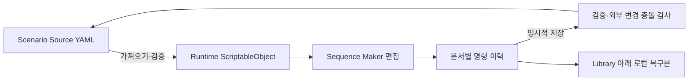

# Sequence Maker 제작 도구와 복구

[학습 홈](README.md) · [전체 코드 색인](20-code-atlas.md) · [이 영역의 모든 파일](code/scenario.md)

Sequence Maker는 단순 Inspector 꾸미기가 아니라 **문서 편집·명령 이력·검증·저장 충돌·복구·실행 관찰**을 가진 편집기입니다. 도구 제작 포트폴리오에서 설명할 경계가 많은 영역입니다.

## 세 표현의 관계

YAML은 저장소의 제작 원본입니다. 편집 중에는 Runtime Asset이 아직 저장하지 않은 변경을 가질 수 있습니다. “원본은 YAML”과 “편집은 Runtime Asset 위에서 한다”는 모순이 아니라 **저장 경계가 분리된 것**입니다.

## 폴더를 창 구성으로 읽기

| 경로 | 역할 |
| --- | --- |
| Scenario/Editor/SequenceMaker | 창 구성, 문서·저장·복구·인덱스 |
| Documents | 문서 단위 상태와 삭제 조정 |
| Flow | 블록 트리의 화면 투영 |
| Inspector | 파라미터 입력 필드 구성 |
| Library | 액션 검색과 최근 사용 |
| Rules | 이벤트 조건 편집·시뮬레이션 |
| Playback | 현재 실행 가능한 장면 컨텍스트 탐색과 재생 |
| Input / Diagnostics | 단축키와 문제 표시 |

## Undo Redo의 실제 자료구조

SequenceEditCommandStack은 이름과 달리 내부 저장에 **List 두 개를 스택처럼** 사용합니다. 명령은 Execute와 Undo 계약을 가집니다. 여러 명령을 한 트랜잭션으로 묶을 수 있고 선택 상태도 함께 복구합니다.

- 새 명령 실행 → undo에 추가, redo 비우기.
- Undo → 역순으로 되돌리고 redo에 보관.
- Redo → 다시 실행하고 undo로 이동.
- 저장 상태는 목록 길이가 아니라 currentStateId와 savedStateId로 비교.

Undo 후 다른 명령을 실행하면 개수가 같아도 내용이 다릅니다. 그래서 “현재 개수 == 저장 때 개수”만으로 저장됨을 판정하면 안 됩니다.

블록은 목록 인덱스가 아니라 안정적인 BlockId로 식별합니다. 순서를 바꿔도 선택·오류·참조가 같은 블록을 가리켜야 하기 때문입니다.

## 외부 수정과 복구

SequenceSaveCoordinator는 내보내기, 검증, 임시 기록 검증, round-trip, 파일 교체, 메타데이터 반영을 구분합니다. 저장 전에 원본 해시가 달라졌다면 외부 수정 충돌을 보여 줍니다. 자동으로 덮어써서는 안 됩니다.

복구본은 `Library/HubToHome/SequenceMakerRecovery`에 둡니다. Assets 아래에 놓으면 별도의 제작 원본처럼 오해하거나 Git에 불필요하게 섞일 수 있습니다. 복구 메타데이터의 경로가 허용된 복구 루트를 벗어나지 않는지도 검사합니다.

## UI Toolkit과 Odin

공식 창은 SequenceMakerWindow입니다. ADR 0006은 초기 UI Toolkit 창과 Odin 편집기를 모두 별도 공식 도구로 유지하는 방법을 거부하고, 하나의 발견 가능한 편집 창으로 모았습니다. Odin 소스가 남아 있어도 공식 제작 진입점이라는 뜻은 아닙니다.

Odin은 데이터의 한국어 라벨·조건부 필드·검사 표시 등에 유용하지만, 명령 이력·파일 충돌·수명 복구 정책을 대신 설계해 주지는 않습니다.

## 주의할 문서 차이

ADR 0003의 “YamlDotNet 선호”는 과거 기술 방향입니다. `ScenarioSourceParser.cs`에는 interface와 MissingYamlScenarioSourceParser가 존재합니다. **그 문서만 보고 현재 모든 파서가 YamlDotNet으로 구현됐다고 주장하지 마세요.** 실제 경로별 SourceParser / SourceSync / ScenarioLibraryYamlUtility를 따라 확인해야 합니다.

## 공부 과제

- [ ] 저장→편집→Undo 때 dirty가 false가 되는 경로를 찾는다.
- [ ] Undo→새 명령에서 기존 Redo가 무효화되는 이유를 설명한다.
- [ ] 외부 YAML 수정 이후 저장 충돌을 사용자에게 어떻게 설명할지 작성한다.
- [ ] 실제 실행 컨텍스트를 interface로 발견하면 편집기가 얻는 이점을 설명한다.

근거: SequenceEditCommandStack, SequenceMakerDocumentSession, SequenceSaveCoordinator, SequenceRecoveryStore, SequenceFlowProjection, ADR 0006.
