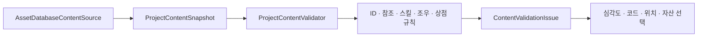

# Editor 콘텐츠 메이커와 검증 도구

[학습 홈](README.md) · [전체 코드 색인](20-code-atlas.md) · [이 영역의 모든 파일](code/editor.md)

Editor 코드는 게임이 실행될 때보다 **사람이 데이터를 만들 때 잘못된 상태를 줄이는 도구**입니다. “파일을 생성했다”보다 “잘못된 참조를 언제 발견하고 기존 작업을 어떻게 보존하는가”가 중요합니다.

## 제작 동선

| 작업 | 메뉴 | 핵심 코드 |
| --- | --- | --- |
| 챕터·방·마커·NPC·대사 | Hub To Home → 제작 → 콘텐츠 메이커 | ContentMakerWindow |
| 스킬과 블록 | Hub To Home → 제작 → 스킬 메이커 | SkillMakerWindow |
| 시퀀스·이벤트 | 공식 Sequence Maker | SequenceMakerWindow |
| 콘텐츠 검사 | Hub To Home → 검사 → 콘텐츠 검사 | ContentValidationWindow |

창은 선택·표시·사용자 명령을 연결하고, 자산 생성·삭제·검증은 서비스가 수행하는 구조로 읽습니다. 창 클래스를 전부 읽기 전에 해당 Service의 입력·출력을 보는 편이 이해하기 쉽습니다.

## 콘텐츠 메이커 분리

- **Maps**: 챕터/방 생성·조회, 삭제 영향 검사.
- **Markers**: 방 안에 상호작용 대상을 배치하고 연결.
- **Dialogue**: 화자·대본·조건 규칙, CSV 교환과 이름 변경 보호.
- **Context / AssetUtility**: 선택 컨텍스트와 경로·자산 작업.

이 도구들이 폴더를 관리하는 이유는 단순 정리 취향이 아닙니다. 런타임 카탈로그, SO 참조, 프리팹 경로, 제작 원본이 함께 맞아야 게임에서 조회되기 때문입니다.

## 검사는 읽기 전용이어야 한다

검사 버튼을 눌렀다는 이유로 ID를 새로 만들거나 자산을 복구하면 프로젝트가 예고 없이 바뀝니다. 수정은 별도의 명시적 명령이어야 합니다.

검사 결과에는 안정적인 오류 코드가 있습니다. 문장만 있으면 번역이나 설명 변경 때 테스트와 자동화가 흔들립니다. 오류 코드는 원인 식별, 한국어 메시지는 사람이 이해하는 설명입니다.

## 제작 도구에서 배울 자료구조

ListView는 선택·목록 탐색의 UI입니다. 리스트 데이터와 선택한 자산 ID를 구분해야 새로고침 뒤에도 사용자의 문맥을 유지합니다. ID 집합·참조 인덱스는 중복·누락 검사를 돕고, 경로 규칙은 생성·삭제 범위를 제한합니다.

삭제 검증은 문자열 접두사 하나로 충분하지 않을 수 있습니다. 정규화된 경로가 정확한 허용 루트 안인지, 다른 자산이 참조하는지 함께 봐야 합니다. 공부 중 실제 자산 삭제를 실험하지 말고 임시 테스트 자산을 사용하세요.

## 테스트와 개발 생성기

Editor/BattleLab은 토끼·ZEV 실험실 콘텐츠와 시각·스토리 샘플을 생성합니다. Development 런타임 세션과 역할이 다릅니다. 생성기 실행이 단순 읽기 검사가 아니라 자산을 변경하는 명령이라는 점도 구분합니다.

## 포트폴리오 설명의 핵심

“비전공자가 버튼 한 번으로 만들게 했다”만으로 끝내지 말고 다음을 보여 주세요.

1. 반복되던 제작 실수: ID 누락, 잘못된 참조, 폴더 분산.
2. 도구가 보장하는 경계: 유효성 검사 뒤 적용, 명시적 수정 명령.
3. 유지 비용: 새 블록이 생길 때 어디를 확장하는가.
4. 검증 근거: 정상 생성뿐 아니라 중복·취소·실패 테스트.

- [ ] 새 스킬의 ID가 중복일 때 검사 결과의 코드와 대상 자산을 찾는다.
- [ ] CSV 파싱 실패가 기존 DialogueData를 바꾸지 않는 테스트를 읽는다.
- [ ] 새로고침으로 선택이 사라지지 않게 어떤 값을 보관하는지 확인한다.

관련: [Sequence Maker](10-sequence-maker.md), [스킬](04-skills.md), [전체 색인](20-code-atlas.md).
