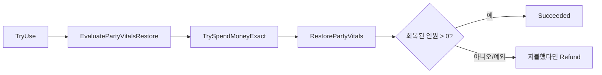

# 04 · 스탯 계산과 장비·상점의 데이터 안전성

> **중심 질문: UI가 무엇을 보여주든, 잘못된 장착·결제가 실제 데이터에 들어가지 않게 하려면?** 숫자 계산과 상태 변경을 서비스 경계에서 읽습니다.

[자료실](README.md) · [캐릭터 입문](https://app.notion.com/p/3f6641f6190181709445c6540fc5f7c1) · [아이템·상점 입문](https://app.notion.com/p/3f6641f619018153b32ecd23efaef43f)

## 01 / 원본 스탯, 장착, 최종 수치를 구분하기

| 소유자 | 담는 값 | 읽는 목적 |
| --- | --- | --- |
| CharacterData / 성장 데이터 | 기본 능력과 성장 규칙 | 시작점 |
| CharacterSaveData | 장비 ID와 현재 HP/AP 등 | 플레이어 진행 |
| EquipmentLoadoutService | 장착 가능 여부와 슬롯 변경 | 잘못된 장착 방지 |
| CharacterStatsCalculator | 보정 합성 | 최종 수치 계산 |
| ShopServiceTransactionService | 회복 평가·결제·보상 | 서비스 거래 결과 |

장비를 끼웠다고 원본 캐릭터 에셋의 ATK를 더했다 빼는 방식이 아닙니다. 보정 목록에서 최종값을 다시 계산하므로 해제/로드 때 역산 오차를 줄일 수 있습니다.

## 02 / 순서가 결과를 바꾸는 스탯 합성

근거 · `Assets/_Game/Scripts/Characters/Runtime/CharacterStats.cs` · 525–549행

```csharp
    private static int ResolvePrimaryValue(int input, StatType type, float flat, float percent)
    {
        double resolved = ((double)input + flat) * (1d + percent);
        int minimum = type == StatType.MaxAP || type == StatType.DEF ? 0 : 1;
        if (double.IsNaN(resolved) || double.IsInfinity(resolved)) return Math.Max(minimum, input);
        // Unity RoundToInt는 .5를 짝수로 보내므로, 스탯은 일반적인 반올림 규칙을 사용한다.
        return (int)Math.Min(int.MaxValue, Math.Floor(Math.Max(minimum, resolved) + 0.5d));
    }

    private static bool IsFinite(float value) => !float.IsNaN(value) && !float.IsInfinity(value);
    private static float SafeMultiplier(float value, float fallback = 1f)
        => IsFinite(value) ? Mathf.Max(0f, value) : fallback;

    // 성장 결과를 시작점으로 장비와 전투 보정을 순서대로 합성한다.
    public static StatBlock Resolve(
        StatBlock progressedBaseStats,
        IReadOnlyList<StatModifier> equipmentModifiers,
        IReadOnlyList<StatModifier> battleModifiers)
    {
        if (progressedBaseStats == null)
            throw new ArgumentNullException(nameof(progressedBaseStats));

        var result = ApplyLayer(progressedBaseStats, StatLayer.Equipment, equipmentModifiers);
        result = ApplyLayer(result, StatLayer.Battle, battleModifiers);
        return result;
```
계산의 핵심은 `(입력 + 고정값 합) × (1 + 비율 합)`입니다. 같은 층의 비율은 더하고, 장비 층을 계산한 결과에 전투 층을 적용합니다. 각 층의 정수 반올림도 결과에 영향을 줍니다.

가정 예시:

| 단계 | 계산 | 결과 ATK |
| --- | --- | --- |
| 성장 완료 기본값 | 100 | 100 |
| 장비 +20, +10% | (100+20)×1.1 | 132 |
| 전투 +10, +50% | (132+10)×1.5 | 213 |

모든 보정을 한 번에 합치면 (100+20+10)×1.6=208이므로 다른 게임 규칙이 됩니다. 클래스가 여러 개라는 것보다 **합성 순서가 명시되어 있다는 것**이 중요합니다.

HP 최대치·ATK·SPD는 최소 1, AP 최대치와 DEF는 최소 0으로 보정합니다. NaN·Infinity는 유효한 숫자가 아니므로 걸러집니다. 피해 저항은 기본 1의 배율 체계이고, 기본 스탯과 ‘0을 기준으로 한 장비 보정값’을 혼동하면 예상과 반대로 커질 수 있습니다.

## 03 / 한 자루를 두 명이 동시에 끼지 않도록

근거 · `Assets/_Game/Scripts/Characters/Runtime/EquipmentLoadoutService.cs` · 100–116행

```csharp
        if (character == null || global == null || !global.Party.Contains(character))
            return Failed(EquipmentChangeStatus.InvalidCharacter, slot, "파티원이 없습니다.");
        if (IsBattleLocked)
            return Failed(EquipmentChangeStatus.Blocked, slot, "전투 중에는 장비를 변경할 수 없습니다.");
        if (equipment == null || string.IsNullOrWhiteSpace(equipment.ItemID))
            return Failed(EquipmentChangeStatus.InvalidEquipment, slot, "장비 데이터가 올바르지 않습니다.");
        if (!TryGetSlotIndex(slot, out int index) || equipment.Slot != slot)
            return Failed(EquipmentChangeStatus.WrongSlot, slot, "선택한 슬롯과 장비 종류가 다릅니다.");

        string equipmentId = equipment.ItemID.Trim();
        EquipmentData registered = EquipmentDatabase.FindById(equipmentId);
        if (registered == null || !ReferenceEquals(registered, equipment))
            return Failed(EquipmentChangeStatus.NotRegistered, slot, "장비가 콘텐츠 카탈로그에 등록되지 않았습니다.");
        if (!equipment.CanEquip(character.CharacterDataID))
            return Failed(EquipmentChangeStatus.CharacterRestricted, slot, "이 캐릭터는 해당 장비를 사용할 수 없습니다.");
        if (GetAvailableCount(global, character, slot, equipmentId) <= 0)
            return Failed(EquipmentChangeStatus.NotOwned, slot, "사용 가능한 장비 수량이 없습니다.");
```
UI에서 후보를 숨겼더라도 서비스가 다시 검증합니다. 파티 소속, 전투 잠금, 올바른 ID, 슬롯, DB 등록 객체, 캐릭터 제한, 남은 수량을 차례로 검사합니다. ID만 같게 만든 미등록 임시 에셋이 정식 장비처럼 들어오는 것도 막습니다.

근거 · `Assets/_Game/Scripts/Characters/Runtime/EquipmentLoadoutService.cs` · 182–197행

```csharp
    /// <summary>현재 캐릭터의 대상 슬롯은 반환 가능한 수량에 포함합니다.</summary>
    public static int GetAvailableCount(
        GlobalDataManager global,
        CharacterSaveData character,
        EquipmentSlot slot,
        string equipmentId)
    {
        if (global == null || character == null || !TryGetSlotIndex(slot, out _))
            return 0;

        string normalizedId = NormalizeId(equipmentId);
        if (string.IsNullOrEmpty(normalizedId))
            return 0;

        return Math.Max(0, global.GetEquipmentCount(normalizedId)
            - CountEquipped(global.Party, normalizedId, character, slot));
```
소유 수량에는 장착된 수량도 포함되고, 사용 가능 수량은 **소유량 − 다른 슬롯에서 사용 중인 양**으로 계산합니다. 현재 바꾸는 슬롯은 제외합니다. 그렇지 않으면 내가 이미 낀 장비조차 ‘남는 수량 0’으로 처리할 수 있습니다.

예: 검 1개 소유, A가 장착 → B에게 남는 수량 0. A가 같은 검을 다시 고르면 이미 장착 결과. A가 해제 → B에게 1개 사용 가능. 장착 때마다 인벤토리에서 빼고 해제 때 더하는 방식과 섞으면 수량이 이중 차감됩니다.

장착 성공 후 `ClampSavedVitals`가 최대 HP/AP에 현재값을 맞춥니다. 최대 HP가 늘었다는 이유만으로 무료 전회복을 주는 처리가 아닙니다. 장비 변경은 읽기 전용 미리보기와 실제 적용을 구분해서 다뤄야 합니다.

## 04 / 회복 상점은 버튼보다 거래 순서가 중요하다



근거 · `Assets/_Game/Scripts/Items/Runtime/ShopServiceTransactionService.cs` · 48–65행

```csharp
            PartyVitalsRestoreEvaluation evaluation = recovery.EvaluatePartyVitalsRestore(service.RestoreHp, service.RestoreAp);
            if (evaluation.Status != PartyVitalsRestoreStatus.Ready)
                return FromEvaluation(evaluation.Status);

            if (service.Price > 0)
            {
                if (!store.TrySpendMoneyExact(service.Price))
                    return new ShopServiceResult(ShopServiceStatus.InsufficientMoney, "돈이 부족하거나 결제할 수 없습니다.");
                paid = true;
            }

            int changed = recovery.RestorePartyVitals(service.RestoreHp, service.RestoreAp);
            if (changed > 0)
                return new ShopServiceResult(ShopServiceStatus.Succeeded, recoveredMembers: changed, price: service.Price);

            ShopServiceResult failure = FromEvaluation(
                recovery.EvaluatePartyVitalsRestore(service.RestoreHp, service.RestoreAp).Status);
            return paid ? Refund(store, service.Price, failure) : failure;
```
먼저 회복 가능 여부를 평가해서 이미 꽉 찬 파티의 불필요한 결제를 피합니다. 지불 뒤 회복을 적용하고 실패하면 돈을 되돌리려고 합니다. 환불 자체가 실패할 수도 있으므로 `RefundFailed`를 별도로 반환합니다.

**설계 해석:** 이것은 실패한 뒤 반대 작업으로 보상하는 방식입니다. 데이터베이스의 완전한 ACID 트랜잭션은 아닙니다. 임의 구현의 `RestorePartyVitals`가 일부 캐릭터를 고친 뒤 예외를 던진다면 돈 환불만으로 HP 변경까지 되돌렸다고 말할 수 없습니다. interface 구현의 계약과 테스트 범위를 같이 봐야 합니다.

자료구조: 장착은 고정 6슬롯, 수량 검사는 파티×슬롯 순회입니다. 파티 P명, 슬롯 S개라면 O(P×S). 적은 파티에서는 계산을 명확히 유지하는 비용이 작습니다. 캐시를 추가하면 모든 장착·해제·로드에서 캐시 일치 책임이 생깁니다.

## 05 / 실습과 예상 결과 — 이번에는 미실행

- [ ] ATK 예시를 `CharacterStatsTests.cs`와 대조하고 고정/비율/층 순서를 바꿔 계산해 본다.
- [ ] 장비 1개를 A가 낀 상태에서 B가 끼려 할 때 NotOwned 경로를 확인한다.
- [ ] 최대 HP 장비를 반복 탈착해 무료 회복이 발생하는지 확인한다.
- [ ] 회복 실패/환불 실패를 가짜 저장소로 나누어 검증한다.

읽을 테스트: `Characters/Tests/Editor/EquipmentAndPowerServicesTests.cs`, `Items/Tests/Editor/ShopTransactionServiceTests.cs`.

면접 질문: **스탯을 증감해서 원복하는 방식보다 재계산하는 방식이 언제 유리한가? 장착 가능 여부를 UI와 서비스에서 모두 검사하는 이유는? 보상 처리와 완전한 트랜잭션의 차이는?**
