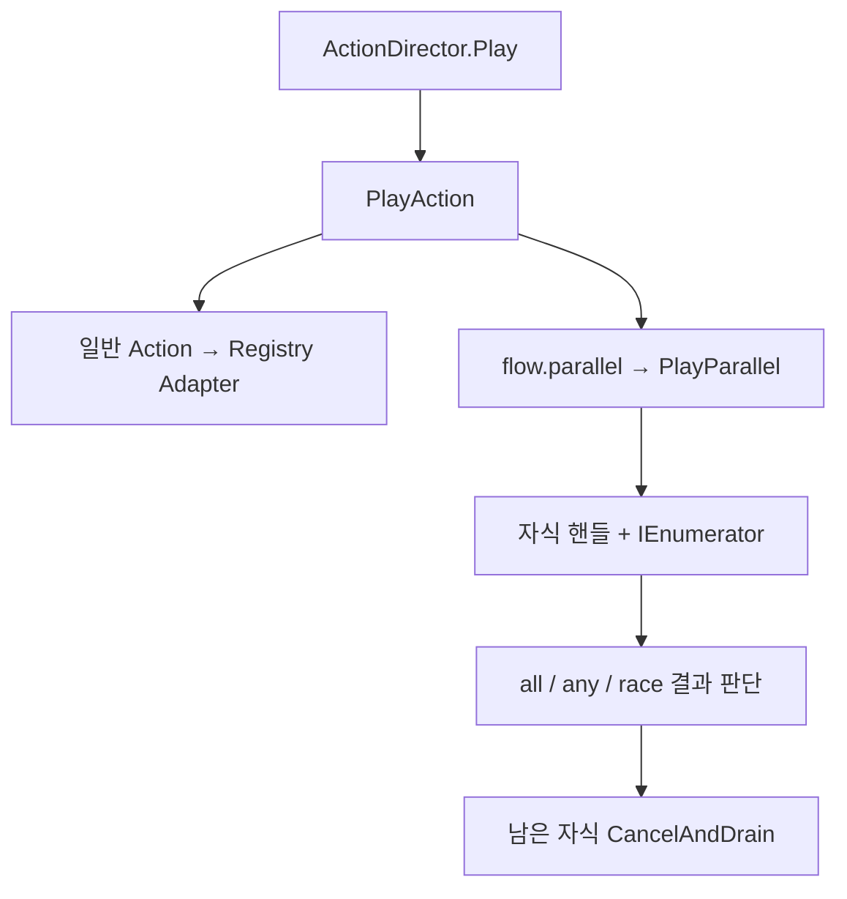

# 06 · 대사와 시나리오가 끝나는 방법

> **중심 질문: 대사를 닫는 순간 다른 전투·연출의 상태를 깨뜨리지 않는가?** 시작보다 종료·취소 경로를 먼저 이해하면 많은 연동 버그를 설명할 수 있습니다.

[자료실](README.md) · [대사 입문](https://app.notion.com/p/3f6641f6190181378747d21bc7355881) · [시나리오 입문](https://app.notion.com/p/3f6641f619018115ad09c59d3afebcbf)

## 01 / 대본, 표시, 연출 실행의 책임

| 구성 | 책임 |
| --- | --- |
| DialogueData / DialogueNode | 대본과 선택지 정의 |
| DialogueManager | 현재 대본·노드·재생 세대·완료/취소 콜백 |
| DialogueUI | 글자·얼굴·선택지·패널 표시 |
| DialogueManagerRunner | 시나리오 실행에서 대사 완료를 기다리는 연결부 |
| ActionDirector | Action ID에 맞는 실행기 선택, 순차/병렬 실행 수명 |
| ActionExecutionHandle | 해당 실행의 상태·취소·결과 |

짧은 전투 말풍선과 메인 대화는 같은 책임이 아닙니다. 말풍선 하나를 띄우는 것 때문에 전체 대사 상태를 독점하도록 만들지 않습니다. 이 장은 메인 대사와 시퀀스 실행을 다룹니다.

## 02 / Dialogue가 끝났다고 Exploration으로 고정하면 안 된다

근거 · `Assets/_Game/Scripts/Dialogue/Runtime/DialogueManager.cs` · 432–449행

```csharp
        _stateBeforeDialogue = stateManager.CurrentState;
        _ownsDialogueState = _stateBeforeDialogue != GameState.Dialogue;
        if (_ownsDialogueState)
            stateManager.ChangeState(GameState.Dialogue);
    }

    private void RestoreDialogueStateIfOwned()
    {
        GameStateManager stateManager = GameStateManager.Instance;
        if (_ownsDialogueState
            && stateManager != null
            && stateManager.CurrentState == GameState.Dialogue)
        {
            stateManager.ChangeState(_stateBeforeDialogue);
        }

        _ownsDialogueState = false;
    }
```
진입 전 상태를 보관하고, 직접 Dialogue 상태로 바꿨을 때만 소유권을 얻습니다. 끝날 때도 현재 상태가 여전히 Dialogue인지 확인합니다. 다른 시스템이 이미 Battle이나 다른 상태로 넘겼다면 옛 대사가 그 결정을 덮어쓰면 안 됩니다.

| 시작 전 | 대사 중 다른 상태 변경 | 끝날 때 |
| --- | --- | --- |
| Exploration | 없음 | Exploration 복구 |
| Battle | 없음 | Battle 복구 |
| Exploration | 외부가 Battle로 전환 | Battle을 유지 |
| 이미 Dialogue | 이 재생이 상태를 얻지 않음 | 임의 복구하지 않음 |

**설계 해석:** 상태를 ‘복원’하려면 내가 바꾼 상태인지 확인해야 합니다. 이것은 모든 시스템이 무조건 글로벌 상태를 리셋하는 설계와 다른 점입니다.

## 03 / 콜백을 부르기 전에 자기 상태를 정리한다

근거 · `Assets/_Game/Scripts/Dialogue/Runtime/DialogueManager.cs` · 396–405행

```csharp
        Action callback = completed ? _onCompleteCallback : _onCancelledCallback;
        _isPlaying = false;
        _isNaming = false;
        _onCompleteCallback = null;
        _onCancelledCallback = null;
        _encounterContext = null;
        _currentDialogue = null;
        _currentNodeIndex = 0;
        _promptChoices = null;
        _promptChoiceCallback = null;
```
완료 여부에 맞는 콜백을 지역 변수로 보관한 후 현재 재생 상태와 필드를 먼저 비웁니다. 이어서 UI를 닫고, 같은 프레임 확인 입력을 소비하고, 소유 상태를 복구한 다음 콜백을 실행합니다. 콜백이 다음 대사를 즉시 시작해도 옛 대사의 정리가 새 대사 필드를 다시 지우지 않게 하기 위한 순서입니다.

`CancelDialogue(int playbackGeneration)`은 현재 재생 세대가 일치할 때만 취소합니다. 이전 시퀀스의 늦은 취소가 새 대사를 끊지 않도록 하는 장치입니다. 단순 bool 하나는 ‘지금 재생 중’은 말할 수 있어도 **어느 재생인지**는 구분하지 못합니다.

## 04 / 여러 연출을 동시에 실행한다는 의미



| 정책 | 종료 기준 | 나머지 자식 |
| --- | --- | --- |
| all | 모든 자식 성공; 실패/취소는 부모에 전파 | 실패/취소 시 중단·정리 |
| any | 첫 성공 | 남은 작업 중단·정리; 모두 실패면 부모 실패 |
| race | 먼저 끝난 유효 자식의 결과 | 성공/실패/취소에 관계없이 나머지 정리 |

`any`와 `race`는 다릅니다. 경고음이 실패해도 다른 화면 연출의 성공을 기다려야 하는 경우와, 처음 끝난 작업의 결과로 전체를 끝내는 경우는 같은 정책이 아닙니다. 건너뛴 블록은 일반 승자와 별도로 처리됩니다.

## 05 / 취소 표시만 하고 방치하면 무엇이 남는가?

근거 · `Assets/_Game/Scripts/Scenario/Runtime/ActionDirector.cs` · 425–434행

```csharp
    private static void CancelAndDrain(List<ParallelRoutine> routines, string message)
    {
        for (int i = 0; i < routines.Count; i++)
        {
            routines[i].Handle.Cancel(message);
            routines[i].Drain();
        }

        routines.Clear();
    }
```
`Cancel()`은 핸들에 취소를 요청하고, `Drain()`은 남은 실행기의 정리를 진행합니다. `ParallelRoutine`은 `Stack<IEnumerator>`로 중첩 코루틴을 관리하며 Dispose 경로를 갖습니다. 이름만 병렬일 뿐 여기의 진행은 코루틴 기반이며 CPU 코어에 자동 분산되는 구조가 아닙니다.

만약 실패한 자식 하나만 지우면 형제의 카메라 이동, 입력 잠금, 패널 표시가 계속 남을 수 있습니다. 그래서 부모 종료와 finally에서도 자식 정리를 호출합니다. 이미 적용한 게임 효과의 되감기와 실행 중인 자원의 해제는 구분해야 합니다.

자료구조: Action 목록은 순서, 자식 실행 목록은 진행 상태, Stack은 중첩 IEnumerator 수명을 나타냅니다. 스택 push/pop 자체는 보통 O(1)이지만 실제 블록 비용까지 O(1)이라는 뜻은 아닙니다. 계층이 깊으면 스택 공간도 깊이에 따라 늘어납니다.

## 06 / 실습과 예상 결과 — 이번에는 미실행

- [ ] Battle에서 메인 대사를 시작하고 정상 종료한다. 예상: 탐색이 아닌 Battle로 복구.
- [ ] 첫 대사를 끝내는 콜백에서 둘째 대사를 시작한다. 예상: 옛 정리가 둘째 재생을 지우지 않음.
- [ ] 과거 generation으로 취소를 요청한다. 예상: 새 대사를 취소하지 않음.
- [ ] flow.parallel의 한 자식이 실패할 때 all/any/race 결과 차이를 표로 작성한다.

테스트: `Dialogue/Tests/Editor/DialogueStateRestoreTests.cs`, `Scenario/Tests/Editor/DialogueManagerRunnerTests.cs`, `ActionDirectorTests.cs`.

면접 질문: **콜백 실행 순서가 왜 재진입 버그와 연결되는가? 취소 토큰과 실제 자원 해제를 왜 분리하는가? 현재 상태만 검사하는 것과 소유권을 검사하는 것은 어떻게 다른가?**
